# Tech Unicorn · Creator Studio & Autonomous Content Pipeline ✨

[](https://github.com/Nexly-Corp/AI/actions)
[](https://github.com/Nexly-Corp/AI/actions)
[](https://kotlinlang.org/docs/multiplatform.html)
[](https://www.jetbrains.com/lp/compose-multiplatform/)
[](https://laravel.com/)

> [!NOTE]
> **Built with ❤️ especially for Delia ([@Tech.Unicorn](https://youtube.com/@TechUnicorn))**
> A personal YouTube studio, autonomous social growth engine, and client empire: find breakout video signals in your tech niche, turn raw thoughts into viral scripts, package uploads, and crush your weekly shipping streak — backed by an in-house AI developer on call 24/7.

---

## 🏗️ System Architecture

```mermaid
flowchart LR
    subgraph Signals["1. Ingestion & Signals"]
        A1["YouTube API Outliers (find_outliers.py)"]
        A2["Competitor Breakout Feeds (≥3x Median)"]
        A3["Flow Voice Dictation (AssemblyAI)"]
    end

    subgraph Studio["2. Creator Studio Core"]
        B1["Idea Bank & Kanban (/ideas)"]
        B2["Script Editor & AI Tells Linter (/scripts)"]
        B3["Fullscreen Teleprompter (/prompter)"]
        B4["Autonomous Agent Swarms (/agents)"]
    end

    subgraph Production["3. Multiplatform Distribution"]
        C1["YouTube 4K Production & AB Title Tests"]
        C2["Omnichannel Repurposer (LinkedIn, X, TikTok, IG)"]
        C3["Code Card Studio (/snippets)"]
    end

    subgraph Business["4. Revenue & Deals CRM"]
        D1["Client Portal & Retainers (/portal)"]
        D2["Interactive Deal Room & Stripe Invoicing (/deal)"]
        D3["Press Kit & Demographics (/mediakit)"]
    end

    Signals --> Studio
    Studio --> Production
    Production --> Business
```



---

## 🚀 Quick Start for Delia (Run Everything Locally 💕)

You can run both the **Web Creator Studio** and the **Native Mobile Companion App** on your computer with simple commands:

### 1. Web Creator Studio (`localhost:8000`)

> [!TIP]
> Ensure you have PHP 8.3+ and Composer installed. The SQLite database is created automatically.

```bash
cd creator-studio
composer install
cp .env.example .env        # First time only
php artisan key:generate    # First time only
touch database/database.sqlite
php artisan migrate
php artisan serve
```

👉 Open **http://localhost:8000** in Chrome. On your first visit, sign in as Studio Owner to activate full admin capabilities.

---

### 2. Live VPS Deployment (Step-by-Step Web Installer `/install`)

Deploying Creator Studio on a production VPS (Ubuntu/Debian) is automated with the built-in step-by-step form:

1. **Clone & install dependencies on your server:**
   ```bash
   git clone https://github.com/your-repo/creator-studio.git /var/www/creator-studio
   cd /var/www/creator-studio/creator-studio
   composer install --no-dev --optimize-autoloader
   npm ci && npm run build
   sudo chown -R www-data:www-data storage bootstrap/cache
   ```
2. **Point your domain & open the installer:**
   Navigate in your browser to:
   ```text
   https://studio.yourdomain.com/install
   ```
3. **The 4-Step Guided Setup:**
   - **Step 1: VPS Pre-flight Checks** (validates PHP 8.2+, PDO MySQL/SQLite, write permissions, extensions via `rachidlaasri/laravel-installer` requirements engine).
   - **Step 2: Database Configuration** (MySQL/MariaDB, SQLite, PostgreSQL with live "Test Connection" button).
   - **Step 3: Delia's Admin Account Creation** (master administrator name, email, password, timezone, currency).
   - **Step 4: AI Keys & Automated Launch** (Gemini/OpenAI API keys, writes `.env`, sets **Google Gemini (Gemini 4 Argon)** as the default AI engine for Copilot and Studio, runs `migrate --force`, and signs in immediately).

---

### 3. Roles & Production Team Management

Creator Studio supports 4 distinct user roles:

| Role | Target User | Capabilities |
| :--- | :--- | :--- |
| **Admin** | Delia (Studio Owner) | Complete studio suite, Team pipeline, Clients management, Settings, optional 2FA |
| **Staff** | Employees / Freelancers | Studio suite, **Team & Production Pipeline** (`/team`), **Publishing QA Checklist** |
| **Client** | Commercial Sponsors & Buyers | Proposals, deliverables, proofing annotations, billing invoices |
| **Member** | Followers & Tech Community | **Follower Community Hub** (`/community`), free starter kits, AMA question board |

- **Staff Provisioning**: Delia can invite video editors, thumbnail artists, and copywriters directly via `/team` or `POST /api/team/staff`.
- **High ROI Production Board**: Kanban stages (`Scripting` → `Filming` → `Editing` → `Review/QA` → `Published`), staff assignments, and the 6-point Content Retention QA Checklist.
- **Social Sign-In**: One-click Google and LinkedIn OAuth authentication for community members, clients, and staff.

---

### 2. Native Mobile Companion App (`mobile/`)

Run the mobile app natively on your laptop with zero emulator overhead via Compose Desktop:

```bash
cd mobile

# On Windows PowerShell:
.\gradlew.bat run

# On macOS / Linux:
./gradlew run
```

> [!IMPORTANT]
> The app opens in an interactive mobile window sized to a flagship smartphone (420 × 880 dp) with complete end-to-end parity:
> - **Tri-State Theme Engine**: Toggle Light / Dark / System with the Sun/Moon switch or `Ctrl+Shift+L`.
> - **Omnibar (`Ctrl+K`)**: Instant search across scripts, ideas, deals, and action commands (`> new script`, `> new post`, `> toggle dark`).
> - **Agentic Copilot (`Ctrl+I`)**: Persistent assistant drawer with streaming AI suggestions and action approvals.
> - **For You Suite**: Direct access to sealed love letters, romantic countdowns, and memory jar prompts.

---

### 3. Flow Push-to-Talk Voice Dictation (`localhost:8000`)

Ramble messy thoughts and instantly receive clean, structured Markdown on your clipboard:

```bash
# Setup Python virtual environment
python3 -m venv .venv && source .venv/bin/activate
pip install -r requirements.txt
cp .env.example .env        # Add your ASSEMBLYAI_API_KEY
uvicorn app:app --port 8000
```

Hold **Space** (or click **Start Speaking**), talk freely, and release to receive polished text.

---

## 📱 Mobile & Web Feature Parity Matrix

| Feature Module | Web Studio (`public/js/`) | Mobile App (`composeApp`) | Capabilities |
| :--- | :---: | :---: | :--- |
| **Omnibar Search (`Ctrl+K`)** | `palette.js` | `OmnibarDialog.kt` | Search scripts, ideas, deals; run prefix commands (`> new script`, `> add deal`) |
| **Theme Engine** | `theme.js` | `Theme.kt` | Authentic palette (`#17131a` midnight plum dark, `#fdfaf8` light), `Ctrl+Shift+L` |
| **Notifications** | `notifications.js` | `NotificationsSheet.kt` | Real-time alerts for booking inquiries, agent sign-offs, and scheduled posts |
| **Copilot Drawer** | `copilot.js` | `CopilotDrawer.kt` | Agentic AI assistant with streaming advice and interactive action cards |
| **Breakouts Radar** | `breakouts.js` | `YouTubeHubScreen.kt` | Flags videos beating channel medians by ≥3x multiplier |
| **Ideas Kanban** | `ideas.js` | `YouTubeHubScreen.kt` | Inbox, greenlit, in-progress backlog with 1-tap script promotion |
| **Script Teleprompter** | `prompter.js` | `YouTubeHubScreen.kt` | Auto-scrolling teleprompter with mirror mode and variable 0.5x–5.0x speed |
| **Content Calendar** | `calendar.js` | `CalendarScreen.kt` | Multi-network schedule for YouTube, LinkedIn, X, TikTok, IG, Threads |
| **Audience Analytics** | `analytics.js` | `AnalyticsScreen.kt` | 472K+ combined reach, platform velocity, best-time posting heatmaps |
| **Unified Inbox** | `inbox.js` | `InboxScreen.kt` | Aggregated comments & DMs with 1-tap AI suggested responses |
| **Code Card Studio** | `snippets.js` | `SnippetsScreen.kt` | Ray.so-style terminal graphics with Unicorn Neon, Cyberpunk, and Sunset themes |
| **Deals CRM & Deal Room** | `deals.js`, `deal-room.js` | `DealRoomScreen.kt` | Pipeline tracker, deliverable tiers, cryptographic e-signature, Stripe payment |
| **Producer AI Chat** | `chat.js` | `ProducerChatScreen.kt` | Conversational thinking partner for packaging, hooks, and strategy |
| **Settings & Security** | `settings.js`, `account.js` | `SettingsScreen.kt`, `AccountScreen.kt` | API keys, connected accounts, 2FA TOTP QR setup, navigation customization |
| **For You (Love Suite)** | `love.js` | `LoveScreen.kt` | Sealed & opened love letters, memory jar prompt logs, milestone countdowns |

---

## 🤖 Next-Gen Multi-Provider AI Engine (Gemini 4 Argon Default)

Creator Studio integrates an enterprise-grade multi-provider AI engine spanning 120+ frontier models with dynamic token accounting, failover key rotation, and adaptive reasoning effort. **Google Gemini** (specifically **Gemini 4 Argon**) serves as the **default out-of-the-box AI engine** across the Creator Dashboard, the Copilot briefing system, and the automated VPS installer.

| Provider | Frontier Models | Capabilities |
| :--- | :--- | :--- |
| **Google Gemini** <br>*(Default Engine)* | • **Gemini 4 Argon** (`gemini-4-argon`) *(Studio Default)*<br>• **Gemini 3.8 Flash** (`gemini-3-8-flash`)<br>• **Gemini 3.7 Flash** (`gemini-3-7-flash`)<br>• **Lyria 3.5** (`lyria-3-5`) | Low-latency autonomous Copilot reasoning, rapid script ideation, 1M+ context window video ingestion, and native generative audio/music composition. |
| **Anthropic Claude** | • **Claude Opus 5.5** (`claude-opus-5-5`)<br>• **Claude Sonnet 5.5** (`claude-sonnet-5-5`)<br>• **Claude Fable 5.1** (`claude-fable-5-1`)<br>• **Claude 3.7 Sonnet** | Deep narrative architecture, multi-perspective script retention audit panels, storytelling hook crafting, and autonomous multi-turn tool calling. |
| **OpenAI** | • **GPT 6 Astra** (`gpt-6-astra`)<br>• **GPT 6 Sol** (`gpt-6-sol`)<br>• **GPT 6 Luna** (`gpt-6-luna`)<br>• **GPT 5.6 Cyber** (`gpt-5-6-cyber`)<br>• **GPT Image 2** (`gpt-image-2`)<br>• **GPT Image 2.5 Flare & Sunburst** | Multimodal reasoning, ultra-fast script editing, code & technical verification, and photorealistic 16:9 thumbnail mockups with volumetric lighting. |
| **DeepSeek** | • **DeepSeek V4 Pro** (`deepseek-v4-pro`)<br>• **DeepSeek V4 Flash Vision Exp** (`deepseek-v4-flash-vision-exp`)<br>• **DeepSeek V4 Flash** (`deepseek-v4-flash`)<br>• **DeepSeek R1 / V3** | Transparent chain-of-thought mathematical reasoning, sponsorship ROI contract verification, multimodal thumbnail critique, and real-time script linting. |
| **xAI Grok** | • **Grok 4.6** (`grok-4-6`)<br>• **Grok 4 / 4.1 Reasoning**<br>• **Grok 3 / 3 Fast / 3 Mini** | Unconstrained creative brainstorming, high-engagement viral social hooks, and real-time cultural trend analysis. |
| **ElevenLabs** | • **ElevenLabs V4** (`elevenlabs-v4`)<br>• **ElevenLabs V4 Turbo** (`elevenlabs-v4-turbo`)<br>• **Voice Isolator & Multilingual v2** | Emotionally nuanced script read-aloud pacing simulation, sub-100ms real-time rehearsal speech synthesis, and studio audio cleanup. |

---

## 📋 YouTube Content Pipeline & Mentor Accountability

### The Mentor Contract (`MENTOR.md`)

```
 1 long-form video / week for 12 weeks
 Baseline: median views of past 5 long-form videos
 Evaluation: Blunt Sunday check-in verdict based on real retention & velocity
```

- **Scoreboard**: Tracked weekly in Notion and reflected in Creator Studio's Today Dashboard.
- **Weekly Check-in**: Runs every Sunday using `ideas/channel_stats.py` (zero tokens) to verify uploads against baseline pace.

<details>
<summary><b>🔍 View Automated Review Pipeline Steps</b></summary>

| Step | Script / Resource | Automation Level | Description |
| :--- | :--- | :---: | :--- |
| **1. Find Outliers** | `ideas/find_outliers.py` | Automated | Scrapes competitor channel IDs for statistical breakout outliers |
| **2. Generate Briefs** | `prompts/01_daily_ideas.md` | Automated | 5 targeted ideas delivered to Notion on schedule |
| **3. Draft Script** | `prompts/02_script.md` | Assisted | Generates structured sections: Hook, Core, Climax, CTA |
| **4. AI Tell Linter** | `review/ai_tells.py` | Automated | Scans drafts for cadence clichés, pacing drop-offs, and filler words |
| **5. 4-Agent Review** | `prompts/03_review_panel.md` | Automated | Retention, Devil's Advocate, Technical Rigor, and Viral Hook agents |
| **6. Substack & Repurpose** | `prompts/04_substack.md` | Assisted | Distills filmed video transcript into newsletter & social carousels |

</details>

---

## 🌐 Chrome Extension (Dictate Everywhere)

`extension/` lets you use Wispr Flow push-to-talk inside **any** web text area (Docs, Gmail, LinkedIn, ChatGPT):

1. Navigate to `chrome://extensions` in Google Chrome.
2. Enable **Developer mode** in the top-right corner.
3. Click **Load unpacked** and select the `c:\AI-master\extension\` directory.
4. Set your Flow server URL, click into any input field, and hold **Option / Alt + Space** to speak.

---

## 🧪 Verification & Automated Testing

Run the comprehensive unit and integration test suites:

```bash
# Mobile Multiplatform & Compose Desktop verification
cd mobile
./gradlew compileKotlinDesktop
./gradlew test
./gradlew assembleDebug

# Python Pipeline & AI Tells Linter tests
cd ..
python -m unittest discover -s tests
python review/ai_tells.py tests/
```

> [!TIP]
> All GitHub Actions workflows (`.github/workflows/creator-studio.yml` and `mobile.yml`) run automated linting, multiplatform compilation, Android APK assembly, and release packaging on every commit.
